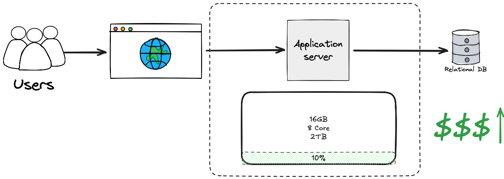
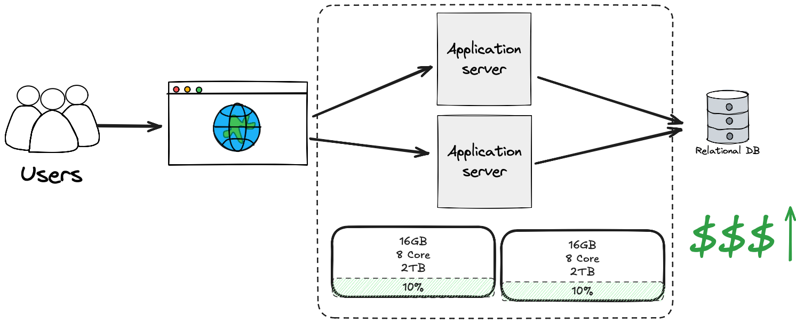
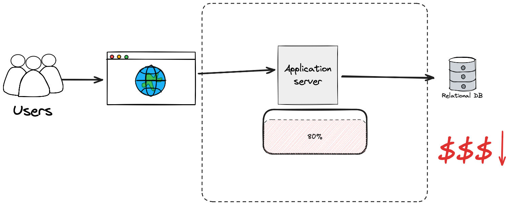
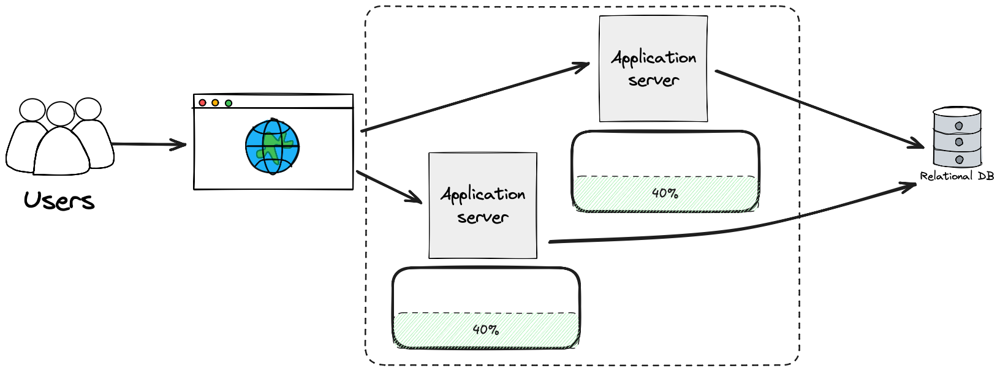
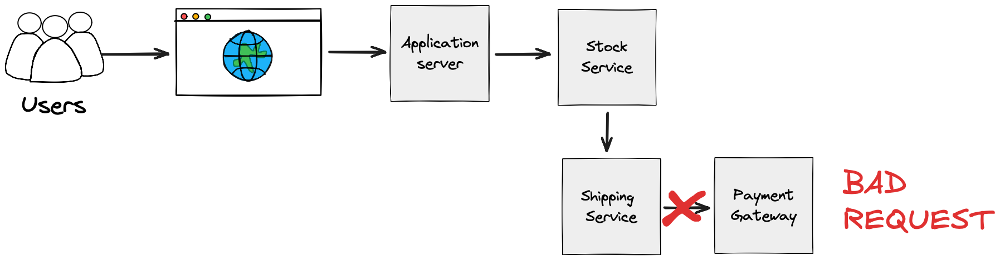
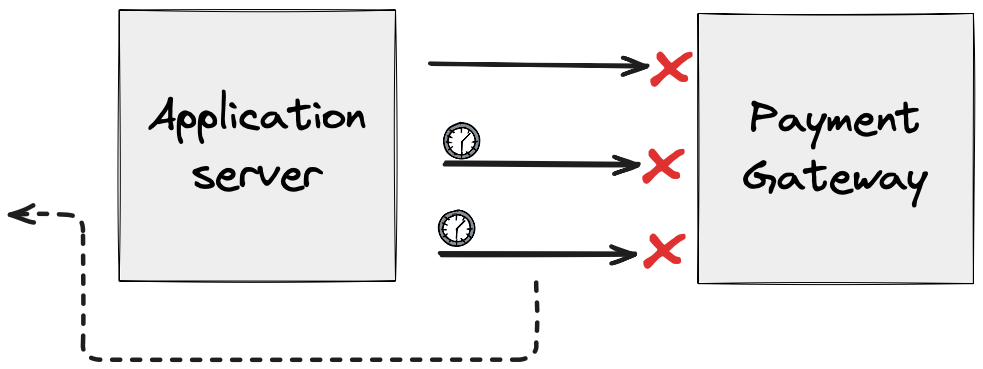
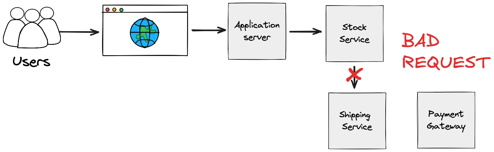
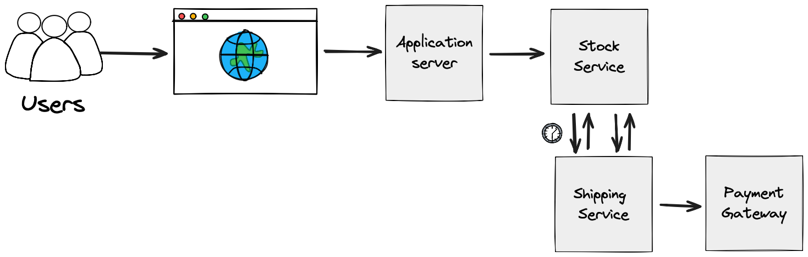
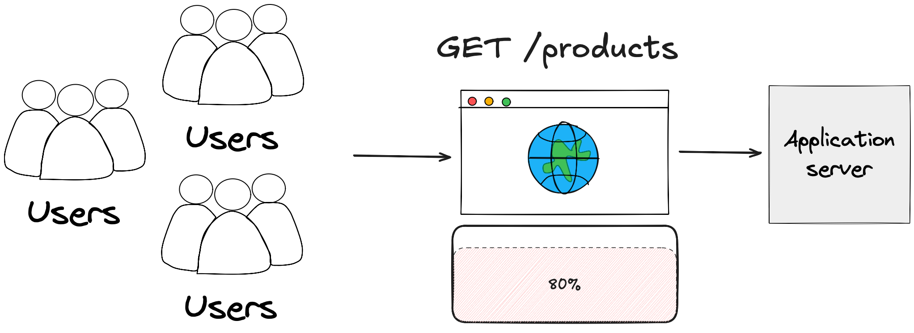

<!-- _class: cover -->

# Design for Failure

Resilience Patterns

<br>

**Luiz Schons**

<!--
Original slide 1.
-->

---

<div class="about">
<div>

<p class="kicker-dark">Who am I?</p>

# Luiz Schons

<p class="role">Senior Software Engineer @ PicPay</p>

<div class="chips">
<span>Canyoneer / Mountaineer</span>
<span>Bodybuilding athlete</span>
<span>BJJ</span>
<span>DevParaná</span>
<span>UTFPR</span>
<span>schons.hashnode.dev</span>
<span>Polyglot.ai &amp; Golazzo</span>
<span>A fun fact…</span>
</div>

</div>

</div>

<!--
Original slide 2.
-->

---

## Disclaimer

- I'm not an expert in anything
- Analyze the scenario you're in
- There is no silver bullet
- Study, and study some more…

<!--
Original slide 3.
-->

---

## What do you mean, "Design for Failure"?

<p>Designing systems assuming failures will happen, not trying to avoid them.</p>

<!--
Original slide 4.
-->

---

## Wait, systems fail?

<p>Yes, and for many reasons - software, hardware, network or external factors.</p>

<!--
Original slide 5.
-->

---

<p>We must build resilient systems that keep working even when failures occur.</p>

<!--
Original slide 6.
-->

---

## Let's put this into practice

<!--
Original slide 7.
-->

---

## The revolutionary idea

<p>You have a brilliant idea for an e-commerce site that will change the world.</p>

<!--
Original slide 8.
-->

---

## The humble beginning

- An old computer as a server
- Installing a web server and a database
- Starting to build the site

<p class="muted"><span class="small">Who hasn't started like this? 😅</span></p>

<!--
Original slide 9.
-->

---

## Your super server

- 4GB of RAM
- Dual-core processor
- 500GB hard drive
- Operating system + Web server + Database

<p class="muted"><span class="small">Practically a datacenter, right? 🤣</span></p>

<!--
Original slide 10.
-->

---

<p class="fig"></p>

<p>You still have few users, so everything works fine.</p>

<!--
Original slide 11.
-->

---

<!-- _class: diagram -->

<p class="fig"></p>

<!--
Original slide 12.
-->

---

## Success brings new challenges

<p>As users grow, your local server starts showing signs of overload.</p>

<p class="fig"></p>

<!--
Original slide 13.
-->

---

## Oh my God, what now?

<p>It's time to rethink the infrastructure: scale to support more users and keep the service running when failures occur.</p>

<!--
Original slide 14.
-->

---

## The Solution: More powerful hardware

<p>Investing in a dedicated server with more computing resources.</p>

<p class="fig"></p>

<!--
Original slide 15.
-->

---

## Done!

## Now you have a powerful server and a bill to pay.

<!--
Original slide 16.
-->

---

## The solution works...

<p class="muted">for now</p>

<p>But you forgot one "small" detail: servers need constant maintenance.</p>

<p class="muted"><span class="small">And you don't have an infrastructure team...</span></p>

<!--
Original slide 17.
-->

---

## Infra superhero

- Installing security updates
- Monitoring resources
- Solving technical problems
- Maintaining the database

<p class="muted"><span class="small">Oh, and in your spare time... building your e-commerce! 😰</span></p>

<!--
Original slide 18.
-->

---

## The nightmares haunt you

- What if the server stops working?
- What if there's a power outage?
- What if the hard drive fails?

<p>Can my business bear that risk?</p>

<!--
Original slide 19.
-->

---

## Now what?

<p>A single server isn't enough...</p>

<p>We need a better strategy!</p>

<!--
Original slide 20.
-->

---

## Time to scale with high availability

<p>The next step: multiple servers to eliminate single points of failure and make sure your e-commerce is always available.</p>

<!--
Original slide 21.
-->

---

<!-- _class: diagram -->

<p class="fig"></p>

<!--
Original slide 22.
-->

---

## High Availability Architecture

<p>Robust infrastructure with a main server, a backup and a separate database — all set up to keep working even when a component fails.</p>

<p class="fig"></p>

<!--
Original slide 23.
-->

---

## Your home datacenter has a problem

- No 24/7 monitoring
- Vulnerable to physical disasters (fire, flood)
- Security risks (theft, break-in)

<p class="muted"><span class="small">Your room wasn't designed to be a professional datacenter...</span></p>

<!--
Original slide 24.
-->

---

## The hidden cost of "saving money"

- Ever-growing hardware investment
- Endless hours of maintenance
- Precious time diverted from your core business
- Constant stress over infrastructure

<p>Cheap turns out expensive... very expensive!</p>

<!--
Original slide 25.
-->

---

## We need something better

<p>A solution that:</p>

- Scales automatically with demand
- Offers high availability without headaches
- Lets you focus on building your business

<!--
Original slide 26.
-->

---

## So what would the solution be?

<p>Anyone have an idea?</p>

<p>What options do we have today to:</p>

- Scale easily
- Reduce maintenance
- Increase availability
- Focus on the business

<!--
Original slide 27.
-->

---

## The answer:

## Cloud Computing

<p>Moving the infrastructure to specialized cloud providers that offer:</p>

- Infrastructure as a service
- On-demand scalability
- High availability with contractual guarantees
- Fewer operational responsibilities

<!--
Original slide 28.
-->

---

## Docker

- Encapsulates applications
- Full portability
- Simplified deployment
- Infrastructure as code

<!--
Original slide 29.
-->

---

## Free Docker course

<p class="fig"></p>

<p class="muted"><span class="small">Fernanda Kipper on YouTube</span></p>

<!--
Original slide 30.
-->

---

<!-- _class: diagram -->

<p class="fig"></p>

<!--
Original slide 31.
-->

---

## Cloud: practical benefits

- Less maintenance
- Automatic scaling
- Managed services
- Automatic backups

<p><em>Focus on the business, not on infrastructure</em></p>

<!--
Original slide 32.
-->

---

<div class="cols middle">
<p class="fig"></p>
<p class="fig"></p>
</div>

<!--
Original slide 33.
-->

---

## Kubernetes

- Orchestrates containers
- Manages replicas automatically
- Ensures service availability

<p>The road to resilience is just beginning...</p>

<!--
Original slide 34.
-->

---

## We're not here to talk about infrastructure

<p>But about how to design systems that survive when things go wrong</p>

<p><em>Because, believe me, they always do! 😅</em></p>

<!--
Original slide 35.
-->

---

## Back to our e-commerce

<!--
Original slide 36.
-->

---

<!-- _class: diagram -->

<p class="fig"></p>

<!--
Original slide 37.
-->

---

## What problems can happen in this flow?

<p>Think about every possible point of failure...</p>

<!--
Original slide 38.
-->

---

## Problems that can happen

- Payment service down
- Shipping calculation service down
- An attack on some system endpoint
- Complexity when adding one more service

<!--
Original slide 39.
-->

---

## Let's understand these problems better

<p>And how we can design our applications to handle them</p>

<!--
Original slide 40.
-->

---

## Payment service down

<!--
Original slide 41.
-->

---

<!-- _class: diagram -->

<p class="fig"></p>

<!--
Original slide 42.
-->

---

<!-- _class: diagram -->

<p class="fig"></p>

<!--
Original slide 43.
-->

---

## How can we handle this?

<!--
Original slide 44.
-->

---

## Retry

<p>Try again after a failure, gradually increasing the wait between attempts:</p>

<p class="fig"></p>

<!--
Original slide 45.
-->

---

## But how do we do this in code?

<!--
Original slide 46.
-->

---

## Universal concepts, different languages

<p>Resilience patterns work in any programming language</p>

<p>Let's see examples on two different platforms:</p>

<!--
Original slide 47.
-->

---

<div class="cols">
<div class="card">

<p class="fig"></p>

## PHP with Hyperf

</div>
<div class="card">

<p class="fig"></p>

## TypeScript with NestJS

</div>
</div>

<p><em>Same problem, same concepts, different implementations</em></p>

<!--
Original slide 48.
-->

---

## Example with PHP and Hyperf

<style scoped>pre{font-size:30px;line-height:1.4;margin:0;padding:24px 30px;}</style>

```php
namespace App\Service;

use Hyperf\Retry\Annotation\Retry;
use Hyperf\Retry\RetryBudget;

class PaymentService
{
    #[Retry(delay: 1000, maxAttempts: 3)]
    public function processPayment()
    {
        // make a remote call
    }
}
```


<!--
Original slide 49.
-->

---

## Example with TypeScript and NestJS

<style scoped>pre{font-size:30px;line-height:1.4;margin:0;padding:24px 30px;}</style>

```typescript
import { Injectable } from '@nestjs/common';
import { Retry } from '@nestjs/axios';
import { catchError, delay, retryWhen } from 'rxjs/operators';
import { of } from 'rxjs';

@Injectable()
export class PaymentService {
    @Retry({ delay: 1000, maxAttempts: 3 })
    async processPayment() {
        // make a remote call
    }
}
```


<!--
Original slide 50.
-->

---

## But Retry has a problem...

<p>What if the service is completely down?</p>

<p>Do we just keep trying forever?</p>

<!--
Original slide 51.
-->

---

## Circuit Breaker

<p>Stops calls to failing services, preventing system overload</p>

<p class="fig"></p>

<!--
Original slide 52.
-->

---

## How does it work?

<p>Inspired by electrical circuit breakers:</p>

- <strong>Closed (normal)</strong>: Allows calls to the service
- <strong>Open (failure)</strong>: Blocks calls after too many errors
- <strong>Half-open</strong>: Allows a few calls to test recovery

<!--
Original slide 53.
-->

---

## Retry vs Circuit Breaker

<div class="cols">
<div class="card">

### Retry

- Tries again after a failure
- Good for temporary failures
- Can overload systems

</div>
<div class="card">

### Circuit Breaker

- Avoids calls to failing services
- Good for persistent failures
- Allows gradual recovery

</div>
</div>

<p>They work best when used together!</p>

<!--
Original slide 54.
-->

---

## Implementation in PHP with Hyperf

<style scoped>pre{font-size:24px;line-height:1.4;margin:0;padding:24px 30px;}pre code{column-count:2;column-gap:48px;display:block;}</style>

```php
namespace App\Services;

use App\Gateway\GatewayServiceClient;
use Hyperf\CircuitBreaker\Annotation\CircuitBreaker;
use Hyperf\Di\Annotation\Inject;

class GatewayService
{
    #[Inject]
    private GatewayServiceClient $client;

    #[CircuitBreaker
    (
        options: ['timeout' => 5000], 
        failCounter: 3, 
        successCounter: 1,
        fallback: 'processPaymentFallback'
    )]
    public function processPayment()
    {
        // make a remote call
    }

    public function processPaymentFallback()
    {
        return 'Service unavailable';
    }
}
```


<!--
Original slide 55.
-->

---

## Implementation in TypeScript with NestJS

<style scoped>pre{font-size:30px;line-height:1.4;margin:0;padding:24px 30px;}</style>

```typescript
import { Injectable } from '@nestjs/common';
import { CircuitBreaker } from '@nestjs/axios';

@Injectable()
export class PaymentService {
    @CircuitBreaker({ 
        timeout: 5000, 
        fallback: () => 'Service unavailable' 
    })
    async processPayment() {
        // make a remote call
    }
}
```


<!--
Original slide 56.
-->

---

## Did you notice a pattern?

<p>Something common to both implementations...</p>

<!--
Original slide 57.
-->

---

<!-- _class: divider -->

# Fallbacks

<!--
Original slide 58.
-->

---

## What are Fallbacks?

- Plan Bs for when something fails
- They can be simple messages or complex alternative logic

<p><em>It's like carrying an umbrella even when the sky is clear</em> 🌂</p>

<!--
Original slide 59.
-->

---

## Fallback in PHP

<style scoped>pre{font-size:17px;line-height:1.4;margin:0;padding:24px 30px;}pre code{column-count:2;column-gap:48px;display:block;}</style>

```php
namespace App\Services;

use App\Gateway\GatewayServiceClient;
use Hyperf\CircuitBreaker\Annotation\CircuitBreaker;
use Hyperf\Di\Annotation\Inject;

class GatewayService
{
    #[Inject]
    private GatewayServiceClient $client;

    #[CircuitBreaker
    (
        options: ['timeout' => 5000], 
        failCounter: 3, 
        successCounter: 1,
        fallback: 'processPaymentFallback'  // Nome do método de fallback
    )]
    public function processPayment()
    {
        // make a remote call
    }

    // Método executado quando um pedido é cancelado
    public function processPaymentFallback()
    {
        return 'Service unavailable';
    }
}
```


<!--
Original slide 60.
-->

---

## Fallback in TypeScript

<style scoped>pre{font-size:30px;line-height:1.4;margin:0;padding:24px 30px;}</style>

```typescript
import { Injectable } from '@nestjs/common';
import { CircuitBreaker } from '@nestjs/axios';

@Injectable()
export class PaymentService {
    @CircuitBreaker({ 
        timeout: 5000, 
        fallback: () => 'Service unavailable'  // Função inline de fallback
    })
    async processPayment() {
        // make a remote call
    }
}
```


<!--
Original slide 61.
-->

---

## And when we have multiple services?

<!--
Original slide 62.
-->

---

## Saga Pattern

<p>Manages distributed transactions in complex systems</p>

<!--
Original slide 63.
-->

---

<!-- _class: diagram -->

<p class="fig"></p>

<!--
Original slide 64.
-->

---

## Saga Pattern + Fallbacks

<p>Robust transactions with recovery at every step</p>

<!--
Original slide 65.
-->

---

<div class="cols">
<div class="card">

### Fallbacks

- Plan B
- Immediate response

</div>
<div class="card">

### Saga

- Distributed transactions
- Error compensation

</div>
</div>


<!--
Original slide 66.
-->

---

## Implementing Compensations

<p>When something fails, we need to undo the previous operations</p>

<!--
Original slide 67.
-->

---

## Compensation in PHP with Hyperf

<style scoped>pre{font-size:18px;line-height:1.4;margin:0;padding:24px 30px;}pre code{column-count:2;column-gap:48px;display:block;}</style>

```php
<?php
namespace App\Listener;

use Hyperf\Event\Contract\ListenerInterface;
use App\Event\OrderCancelled;

class OrderCancelledListener implements ListenerInterface
{
    public function listen(): array
    {
        return [OrderCancelled::class];
    }

    // Método chamado quando um pedido é cancelado
    public function process(object $event): void
    {
        // Extrai informações do evento
        $orderId = $event->orderId;
        
        // Compensa as etapas anteriores (saga pattern)
        $this->refundPayment($orderId);
        $this->returnInventory($orderId);
        $this->notifyCustomer($orderId, 'Seu pedido foi cancelado');
        $this->logCancellation($orderId, $event->reason);
    }
}
```


<!--
Original slide 68.
-->

---

## Compensation in NestJS with RabbitMQ

<style scoped>pre{font-size:15px;line-height:1.4;margin:0;padding:24px 30px;}pre code{column-count:2;column-gap:48px;display:block;}</style>

```typescript
import { RabbitSubscribe } from '@golevelup/nestjs-rabbitmq';
import { Injectable } from '@nestjs/common';
import { PaymentService } from '../services/payment.service';
import { InventoryService } from '../services/inventory.service';
import { NotificationService } from '../services/notification.service';
import { LoggingService } from '../services/logging.service';

@Injectable()
export class OrderCancelledListener {
  constructor(
    private paymentService: PaymentService,
    private inventoryService: InventoryService,
    private notificationService: NotificationService,
    private loggingService: LoggingService,
  ) {}

  @RabbitSubscribe({
    exchange: 'order_exchange',
    routingKey: 'order.cancelled',
    queue: 'order-cancelled-queue',
  })
  async handleCancellation(msg: { orderId: number; reason: string }) {
    // Compensação para cada etapa anterior (saga pattern)
    await this.paymentService.refund(msg.orderId);
    await this.inventoryService.restoreStock(msg.orderId);
    await this.notificationService.notify(msg.orderId, 'Seu pedido foi cancelado');
    await this.loggingService.logCancellation(msg.orderId, msg.reason);
  }
}
```


<!--
Original slide 69.
-->

---

## See how the Saga pattern works

<p class="fig"></p>

<p class="muted"><span class="small">Each action has its matching compensation</span></p>

<!--
Original slide 70.
-->

---

## Another common problem:

## Shipping Calculation API Unavailable

<!--
Original slide 71.
-->

---

## Scenario:

- A customer is checking out
- The Correios (postal service) shipping API is down
- If we can't calculate shipping, we lose the sale

<p>How do we deal with this kind of problem?</p>

<!--
Original slide 72.
-->

---

<!-- _class: diagram -->

<p class="fig"></p>

<!--
Original slide 73.
-->

---

## How can we solve this?

<!--
Original slide 74.
-->

---

## Cache + Default Values

<p>A strategy for dealing with unavailable external services</p>

<!--
Original slide 75.
-->

---

## Cache Implementation

<style scoped>pre{font-size:17px;line-height:1.4;margin:0;padding:24px 30px;}pre code{column-count:2;column-gap:48px;display:block;}</style>

```php
namespace App\Services;

use App\Shipping\ShippingServiceClient;
use Hyperf\CircuitBreaker\Annotation\CircuitBreaker;
use Hyperf\Di\Annotation\Inject;
                
class GatewayService
{
    #[Inject]
    private ShippingServiceClient $client;

    #[CircuitBreaker
    (
        options: ['timeout' => 5000],
        failCounter: 3,
        successCounter: 1,
        fallback: 'processCalculateShippingFallback'
    )]
    public function processCalculateShipping($order)
    {
        // Tenta calcular o frete usando a API externa
        $shipping = $this->client
            ->calculateShipping($order);
        
        // Salva o resultado em cache para uso futuro
        $this->cacheShipping($order, $shipping);

        // Retorna o resultado do cálculo
        return $shipping;
    }

    // Método executado quando o circuito abre
    public function processCalculateShippingFallback($order)
    {
        // Retorna um valor padrão ou cache com base no último cálculo
        $cachedShipping = $this->getCachedShipping($order);
        if ($cachedShipping) {
            return $cachedShipping;
        }
        // Se não houver cache, retorna um valor padrão
        return [
            'price' => 40.00, // Valor fixo de frete
            'deliveryTime' => '5-7 dias úteis', // Tempo de entrega padrão
        ];
    }
}
```


<!--
Original slide 76.
-->

---

## Summing up what we learned

<p class="fig"></p>

<p class="muted"><span class="small">A resilient system combines multiple strategies</span></p>

<!--
Original slide 77.
-->

---

## Another common problem:

<!--
Original slide 78.
-->

---

## Problem: Attacks or Excessive Traffic

<p class="muted">Product listing endpoint overloaded</p>

<!--
Original slide 79.
-->

---

## Normal scenario: Few users

<p>The GET /products endpoint responds quickly for each user</p>

<!--
Original slide 80.
-->

---

<p class="fig"></p>

<p class="muted"><span class="small">Server resources are enough to serve everyone</span></p>

<!--
Original slide 81.
-->

---

## Problem scenario: Many users or an attack

- Bots scraping your store
- Denial-of-service attack (DDoS)
- Traffic spikes during sales

<!--
Original slide 82.
-->

---

<p class="fig"></p>

<p class="muted"><span class="small">The server gets overloaded and nobody can use the system</span></p>

<!--
Original slide 83.
-->

---

## Solution: Rate Limiting

<p>Limits the number of requests a client can make in a period of time</p>

<!--
Original slide 84.
-->

---

## How it works:

- Sets limits per IP, user or token
- Counts requests in time windows
- Rejects requests when the limit is reached
- Returns a 429 error (Too Many Requests)
- Returns cached content for repeated requests

<!--
Original slide 85.
-->

---

## Implementation in NestJS

<style scoped>pre{font-size:18px;line-height:1.4;margin:0;padding:24px 30px;}pre code{column-count:2;column-gap:48px;display:block;}</style>

```typescript
import { Injectable, NestMiddleware } from '@nestjs/common';
import { Request, Response, NextFunction } from 'express';
import { RateLimiterRedis } from 'rate-limiter-flexible';

@Injectable()
export class RateLimiterMiddleware implements NestMiddleware {
  private rateLimiter: RateLimiterRedis;
  
  constructor() {
    // Configuração do rate limiter
    this.rateLimiter = new RateLimiterRedis({
      storeClient: redisClient,
      points: 60, // Número de requisições permitidas
      duration: 60, // Por minuto
    });
  }

  async use(req: Request, res: Response, next: NextFunction) {
    try {
      // Usa o IP como identificador
      const key = req.ip;
      await this.rateLimiter.consume(key);
      next();
    } catch (error) {
      // Limite excedido
      const retryAfter = Math.round(error.msBeforeNext / 1000) || 1;
      
      res.set('Retry-After', String(retryAfter));
      res.status(429).json({
        error: 'Muitas requisições, tente novamente mais tarde',
        retryAfter
      });
    }
  }
}
```


<!--
Original slide 86.
-->

---

## Benefits of Rate Limiting

- Protects against brute-force attacks
- Prevents a single client from hogging resources
- Keeps the system available for all users
- Reduces infrastructure costs

<p><em>Balances load for fairer service</em></p>

<!--
Original slide 87.
-->

---

## But what about adding new services?

<p>How do we expand our system without breaking what already works?</p>

<!--
Original slide 88.
-->

---

## Open/Closed Principle

<p>The SOLID Open/Closed Principle</p>

> "Software entities should be open for extension, but closed for modification."

<p>In other words: add behavior without touching existing code</p>

<!--
Original slide 89.
-->

---

## Example: Multiple shipping providers

<p>What if we want to add new providers besides Correios?</p>

<!--
Original slide 90.
-->

---

## Interface and implementations

<style scoped>pre{font-size:15px;line-height:1.4;margin:0;padding:24px 30px;}pre code{column-count:2;column-gap:48px;display:block;}</style>

```php
// Interface comum para todos os provedores de frete
interface ShippingProviderInterface
{
    /**
     * Calcula o frete para um pedido
     */
    public function calculateShipping(array $order): array;
    public function trackShipment(string $trackingCode): array;
    public function getName(): string;
}

// Implementação para os Correios (já existente)
class CorreiosShippingProvider implements ShippingProviderInterface
{
    public function calculateShipping(array $order): array
    {
        // Lógica específica dos Correios
        return [
            'price' => 35.90,
            'delivery_time' => '3-5 dias úteis',
            'provider' => 'Correios'
        ];
    }
    
    // Outras implementações de métodos...
}

// Nova implementação para transportadora sem modificar código existente
class FastShippingProvider implements ShippingProviderInterface
{
    public function calculateShipping(array $order): array
    {
        // Lógica específica da transportadora privada
        return [
            'price' => 45.90,
            'delivery_time' => '1-2 dias úteis',
            'provider' => 'FastShipping'
        ];
    }
    
    // Outras implementações de métodos...
}

// Factory que seleciona o provedor apropriado
class ShippingProviderFactory
{
    private array $providers = [];
    
    public function registerProvider(ShippingProviderInterface $provider): void
    {
        $this->providers[$provider->getName()] = $provider;
    }
    
    public function getProvider(string $name): ?ShippingProviderInterface
    {
        return $this->providers[$name] ?? null;
    }
    
    public function getAllProviders(): array
    {
        return $this->providers;
    }
}
```


<!--
Original slide 91.
-->

---

## Using the factory

<style scoped>pre{font-size:23px;line-height:1.4;margin:0;padding:24px 30px;}</style>

```php
// Configuração da aplicação
$factory = new ShippingProviderFactory();

// Registramos todos os provedores disponíveis
$factory->registerProvider(new CorreiosShippingProvider());
$factory->registerProvider(new FastShippingProvider());
// Podemos adicionar novos provedores aqui sem modificar o código existente
$factory->registerProvider(new InternationalShippingProvider());

// Cliente escolhe qual provedor usar
$providerName = $_POST['shipping_provider'] ?? 'Correios';
$provider = $factory->getProvider($providerName);

// Calculamos o frete usando o provedor escolhido
if ($provider) {
    return $provider->calculateShipping($order);
}

return [
    'error' => 'Provedor de frete não encontrado',
    'available_providers' => $factory->getAllProviders()
];
```


<!--
Original slide 92.
-->

---

## Benefits of the Open/Closed Principle

- More stable, less bug-prone code
- We can add new providers without risk
- Existing tests stay valid
- Makes the system easier to maintain and extend

<p>By applying SOLID, we gain resilience and flexibility.</p>

<!--
Original slide 93.
-->

---

<!-- _class: divider -->

# Recap

<p>Which resilience patterns did we see today?</p>

<!--
Original slide 94.
-->

---

## Retry

<p>Trying again after a failure, gradually increasing the wait between attempts.</p>

<!--
Original slide 95.
-->

---

## Circuit Breaker

<p>Stopping calls to services with persistent failures, preventing overload and allowing gradual recovery.</p>

<!--
Original slide 96.
-->

---

## Fallbacks

<p>Plan Bs for when something fails, offering alternatives instead of letting the operation fail completely.</p>

<!--
Original slide 97.
-->

---

## Saga Pattern

<p>Managing distributed transactions in complex systems, with compensations to undo operations on failure.</p>

<!--
Original slide 98.
-->

---

## Cache + Default Values

<p>Storing operation results for use when external services are unavailable, improving availability.</p>

<!--
Original slide 99.
-->

---

## Rate Limiting

<p>Limiting the number of requests a client can make in a period, protecting against abuse and distributing resources fairly.</p>

<!--
Original slide 100.
-->

---

## Open/Closed Principle

<p>Adding new behavior without modifying existing code, increasing flexibility and reducing risk.</p>

<!--
Original slide 101.
-->

---

## Next steps

- Study resilience patterns further
- Apply these concepts in your projects
- Join communities and share experiences

<!--
Original slide 102.
-->

---

## Conclusion

- Failures are inevitable
- Resilient systems anticipate and adapt to failures
- Combine different patterns for greater robustness
- Resilience must be part of the initial design

<p><strong>Design for failure!</strong></p>

<!--
Original slide 103.
-->

---

<!-- _paginate: false -->

<div class="qr-slide">
<div>

## Thank you!

<p>Luiz Schons</p>

<p class="muted"><span class="small">Senior Software Architect</span></p>

</div>
<figure class="qr">

<figcaption>linkedin.com/in/luiz-schons</figcaption>
</figure>
</div>

<!--
Original slide 104.
-->
