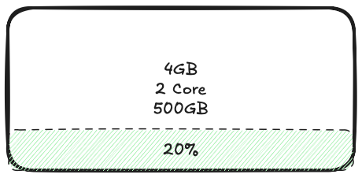
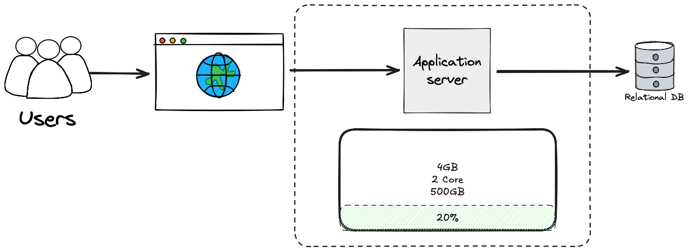
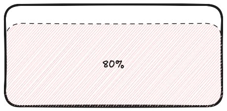
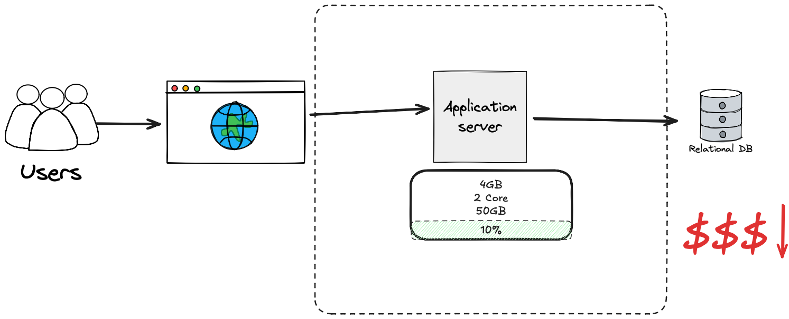
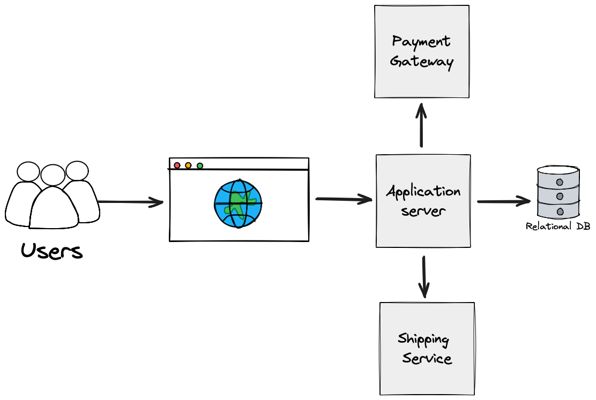
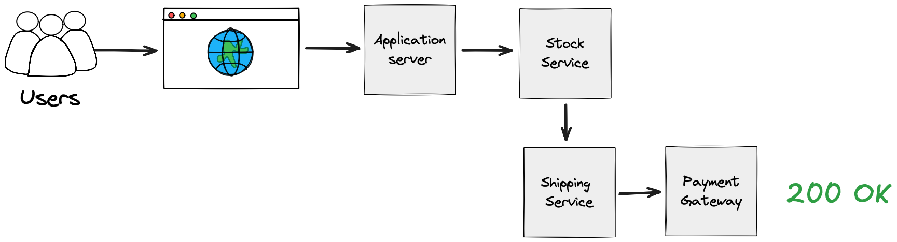
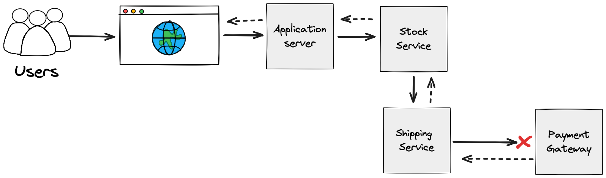
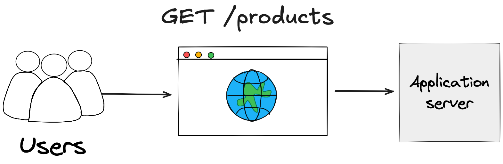

<!-- _class: cover -->

# Design for Failure

Padrões de Resiliência

<br>

**Luiz Schons**

<!--
Slide original 1.
-->

---

<div class="about">
<div>

<p class="kicker-dark">Quem sou eu?</p>

# Luiz Schons

<p class="role">Senior Software Engineer @ PicPay</p>

<div class="chips">
<span>Canionista / Montanhista</span>
<span>Atleta de CA</span>
<span>BJJ</span>
<span>DevParaná</span>
<span>UTFPR</span>
<span>schons.hashnode.dev</span>
<span>Polyglot.ai &amp; Golazzo</span>
<span>Uma curiosidade…</span>
</div>

</div>

</div>

<!--
Slide original 2.
-->

---

## Disclaimer

- Não sou especialista em nada
- Analise o cenário que você está
- Não existe bala de prata
- Estude e estude…

<!--
Slide original 3.
-->

---

## Como assim "Design for Failure"?

<p>Projetar sistemas assumindo que falhas vão acontecer, não tentando evitá-las.</p>

<!--
Slide original 4.
-->

---

## Mas perai, sistemas falham?

<p>Sim, e por diversos motivos - software, hardware, rede ou fatores externos.</p>

<!--
Slide original 5.
-->

---

<p>Devemos construir sistemas resilientes que continuem funcionando mesmo quando falhas ocorrem.</p>

<!--
Slide original 6.
-->

---

## Vamos colocar isso na prática

<!--
Slide original 7.
-->

---

## A ideia revolucionária

<p>Você tem uma ideia brilhante para um e-commerce que vai mudar o mundo.</p>

<!--
Slide original 8.
-->

---

## O início modesto

- Um computador antigo como servidor
- Instalação de servidor web e banco de dados
- Início do desenvolvimento do site

<p class="muted"><span class="small">Quem nunca começou assim? 😅</span></p>

<!--
Slide original 9.
-->

---

## Seu super servidor

- 4GB de RAM
- Processador dual-core
- HD de 500GB
- Sistema operacional + Servidor web + Banco de dados

<p class="muted"><span class="small">Parece até datacenter, não é mesmo? 🤣</span></p>

<!--
Slide original 10.
-->

---

<p class="fig"></p>

<p>Você ainda tem poucos usuários, então tudo funciona bem.</p>

<!--
Slide original 11.
-->

---

<!-- _class: diagram -->

<p class="fig"></p>

<!--
Slide original 12.
-->

---

## O sucesso traz novos desafios

<p>Com o aumento de usuários, seu servidor local começa a mostrar sinais de sobrecarga.</p>

<p class="fig"></p>

<!--
Slide original 13.
-->

---

## Meu Deus, o que fazer?

<p>É hora de repensar a infraestrutura: escalar para suportar mais usuários e garantir a continuidade do serviço quando falhas ocorrerem.</p>

<!--
Slide original 14.
-->

---

## A Solução: Hardware mais potente

<p>Investimento em um servidor dedicado com mais recursos computacionais.</p>

<p class="fig"></p>

<!--
Slide original 15.
-->

---

## Pronto!

## Agora você tem um servidor potente e uma conta para pagar.

<!--
Slide original 16.
-->

---

## A solução funciona...

<p class="muted">por enquanto</p>

<p>Mas você esqueceu de um "pequeno" detalhe: servidores precisam de manutenção constante.</p>

<p class="muted"><span class="small">E você não tem uma equipe de infraestrutura...</span></p>

<!--
Slide original 17.
-->

---

## Super-herói da infra

- Instalação de atualizações de segurança
- Monitoramento de recursos
- Resolução de problemas técnicos
- Manutenção do banco de dados

<p class="muted"><span class="small">Ah, e no tempo livre... desenvolver o seu e-commerce! 😰</span></p>

<!--
Slide original 18.
-->

---

## Os pesadelos te assombram

- E se o servidor parar de funcionar?
- E se ocorrer uma queda de energia?
- E se o disco rígido falhar?

<p>Meu negócio pode suportar esse risco?</p>

<!--
Slide original 19.
-->

---

## E agora?

<p>Um único servidor não é suficiente...</p>

<p>Precisamos de uma estratégia melhor!</p>

<!--
Slide original 20.
-->

---

## Hora de escalar com alta disponibilidade

<p>O próximo passo: múltiplos servidores para eliminar pontos únicos de falha e garantir que seu e-commerce esteja sempre disponível.</p>

<!--
Slide original 21.
-->

---

<!-- _class: diagram -->

<p class="fig"></p>

<!--
Slide original 22.
-->

---

## Arquitetura de Alta Disponibilidade

<p>Infraestrutura robusta com servidor principal, backup e banco de dados separado — tudo configurado para continuar funcionando mesmo quando um componente falha.</p>

<p class="fig"></p>

<!--
Slide original 23.
-->

---

## Seu datacenter caseiro tem um problema

- Falta de monitoramento 24/7
- Vulnerabilidade a desastres físicos (incêndio, inundação)
- Riscos de segurança (roubo, invasão)

<p class="muted"><span class="small">Sua sala não foi projetada para ser um datacenter profissional...</span></p>

<!--
Slide original 24.
-->

---

## O custo oculto da "economia"

- Investimento crescente em hardware
- Horas intermináveis de manutenção
- Tempo precioso desviado do seu negócio principal
- Estresse constante com a infraestrutura

<p>O barato sai caro... muito caro!</p>

<!--
Slide original 25.
-->

---

## Precisamos de algo melhor

<p>Uma solução que:</p>

- Escale automaticamente conforme a demanda
- Ofereça alta disponibilidade sem dores de cabeça
- Permita foco no desenvolvimento do seu negócio

<!--
Slide original 26.
-->

---

## E qual seria a solução?

<p>Alguém tem alguma ideia?</p>

<p>Quais opções temos hoje para:</p>

- Escalar facilmente
- Reduzir manutenção
- Aumentar disponibilidade
- Focar no negócio

<!--
Slide original 27.
-->

---

## A resposta:

## Cloud Computing

<p>Migração da infraestrutura para provedores especializados em nuvem que oferecem:</p>

- Infraestrutura como serviço
- Escalabilidade sob demanda
- Alta disponibilidade com garantias por contrato
- Redução de responsabilidades operacionais

<!--
Slide original 28.
-->

---

## Docker

- Encapsula aplicações
- Portabilidade total
- Deploy simplificado
- Infraestrutura como código

<!--
Slide original 29.
-->

---

## Curso gratuito de Docker

<p class="fig"></p>

<p class="muted"><span class="small">Fernanda Kipper no YouTube</span></p>

<!--
Slide original 30.
-->

---

<!-- _class: diagram -->

<p class="fig"></p>

<!--
Slide original 31.
-->

---

## Cloud: benefícios práticos

- Menos manutenção
- Escala automática
- Serviços gerenciados
- Backups automáticos

<p><em>Foco no negócio, não na infraestrutura</em></p>

<!--
Slide original 32.
-->

---

<div class="cols middle">
<p class="fig"></p>
<p class="fig"></p>
</div>

<!--
Slide original 33.
-->

---

## Kubernetes

- Orquestra containers
- Gerencia réplicas automaticamente
- Garante disponibilidade dos serviços

<p>O caminho para a resiliência está apenas começando...</p>

<!--
Slide original 34.
-->

---

## Não estamos aqui para falar de infraestrutura

<p>Mas sim de como projetar sistemas que sobrevivam quando as coisas dão errado</p>

<p><em>Porque, acredite, elas sempre dão! 😅</em></p>

<!--
Slide original 35.
-->

---

## Voltando ao nosso e-commerce

<!--
Slide original 36.
-->

---

<!-- _class: diagram -->

<p class="fig"></p>

<!--
Slide original 37.
-->

---

## Quais problemas podem ocorrer neste fluxo?

<p>Pense em todos os pontos de falha possíveis...</p>

<!--
Slide original 38.
-->

---

## Problemas que podem ocorrer

- Serviço de pagamento fora do ar
- Serviço de calcular frete fora do ar
- Ataque em algum endpoint do sistema
- Complexidade ao adicionar mais um serviço

<!--
Slide original 39.
-->

---

## Vamos entender esses problemas melhor

<p>E como podemos projetar nossas aplicações para lidar com eles</p>

<!--
Slide original 40.
-->

---

## Serviço de pagamento fora do ar

<!--
Slide original 41.
-->

---

<!-- _class: diagram -->

<p class="fig"></p>

<!--
Slide original 42.
-->

---

<!-- _class: diagram -->

<p class="fig"></p>

<!--
Slide original 43.
-->

---

## Como podemos lidar com isso?

<!--
Slide original 44.
-->

---

## Retry

<p>Tente novamente após uma falha, aumentando gradualmente o tempo de espera entre tentativas:</p>

<p class="fig"></p>

<!--
Slide original 45.
-->

---

## Mas como que fazemos isso com código?

<!--
Slide original 46.
-->

---

## Conceitos universais, diferentes linguagens

<p>Os padrões de resiliência funcionam em qualquer linguagem de programação</p>

<p>Vamos ver exemplos em duas plataformas diferentes:</p>

<!--
Slide original 47.
-->

---

<div class="cols">
<div class="card">

<p class="fig"></p>

## PHP com Hyperf

</div>
<div class="card">

<p class="fig"></p>

## TypeScript com NestJS

</div>
</div>

<p><em>Mesmo problema, mesmos conceitos, diferentes implementações</em></p>

<!--
Slide original 48.
-->

---

## Exemplo com PHP e Hyperf

<style scoped>pre{font-size:30px;line-height:1.4;margin:0;padding:24px 30px;}</style>

```php
namespace App\Service;

use Hyperf\Retry\Annotation\Retry;
use Hyperf\Retry\RetryBudget;

class PaymentService
{
    #[Retry(delay: 1000, maxAttempts: 3)]
    public function processPayment()
    {
        // make a remote call
    }
}
```


<!--
Slide original 49.
-->

---

## Exemplo com TypeScript e NestJS

<style scoped>pre{font-size:30px;line-height:1.4;margin:0;padding:24px 30px;}</style>

```typescript
import { Injectable } from '@nestjs/common';
import { Retry } from '@nestjs/axios';
import { catchError, delay, retryWhen } from 'rxjs/operators';
import { of } from 'rxjs';

@Injectable()
export class PaymentService {
    @Retry({ delay: 1000, maxAttempts: 3 })
    async processPayment() {
        // make a remote call
    }
}
```


<!--
Slide original 50.
-->

---

## Mas o Retry tem um problema...

<p>E se o serviço estiver completamente fora do ar?</p>

<p>Vamos ficar tentando sem parar?</p>

<!--
Slide original 51.
-->

---

## Circuit Breaker

<p>Interrompe chamadas a serviços com falhas, prevenindo sobrecarga do sistema</p>

<p class="fig"></p>

<!--
Slide original 52.
-->

---

## Como funciona?

<p>Inspirado nos disjuntores elétricos:</p>

- <strong>Fechado (normal)</strong>: Permite as chamadas ao serviço
- <strong>Aberto (falha)</strong>: Bloqueia chamadas após muitos erros
- <strong>Semi-aberto</strong>: Permite algumas chamadas para testar recuperação

<!--
Slide original 53.
-->

---

## Retry vs Circuit Breaker

<div class="cols">
<div class="card">

### Retry

- Tenta novamente após falha
- Bom para falhas temporárias
- Pode sobrecarregar sistemas

</div>
<div class="card">

### Circuit Breaker

- Evita chamadas a serviços falhos
- Bom para falhas persistentes
- Permite recuperação gradual

</div>
</div>

<p>Funcionam melhor quando usados em conjunto!</p>

<!--
Slide original 54.
-->

---

## Implementação em PHP com Hyperf

<style scoped>pre{font-size:24px;line-height:1.4;margin:0;padding:24px 30px;}pre code{column-count:2;column-gap:48px;display:block;}</style>

```php
namespace App\Services;

use App\Gateway\GatewayServiceClient;
use Hyperf\CircuitBreaker\Annotation\CircuitBreaker;
use Hyperf\Di\Annotation\Inject;

class GatewayService
{
    #[Inject]
    private GatewayServiceClient $client;

    #[CircuitBreaker
    (
        options: ['timeout' => 5000], 
        failCounter: 3, 
        successCounter: 1,
        fallback: 'processPaymentFallback'
    )]
    public function processPayment()
    {
        // make a remote call
    }

    public function processPaymentFallback()
    {
        return 'Service unavailable';
    }
}
```


<!--
Slide original 55.
-->

---

## Implementação em TypeScript com NestJS

<style scoped>pre{font-size:30px;line-height:1.4;margin:0;padding:24px 30px;}</style>

```typescript
import { Injectable } from '@nestjs/common';
import { CircuitBreaker } from '@nestjs/axios';

@Injectable()
export class PaymentService {
    @CircuitBreaker({ 
        timeout: 5000, 
        fallback: () => 'Service unavailable' 
    })
    async processPayment() {
        // make a remote call
    }
}
```


<!--
Slide original 56.
-->

---

## Vocês perceberam algum padrão?

<p>Algo comum nas duas implementações...</p>

<!--
Slide original 57.
-->

---

<!-- _class: divider -->

# Fallbacks

<!--
Slide original 58.
-->

---

## O que são Fallbacks?

- Planos B para quando algo falha
- Podem ser simples mensagens ou lógicas alternativas complexas

<p><em>É como levar um guarda-chuva mesmo quando o céu está limpo</em> 🌂</p>

<!--
Slide original 59.
-->

---

## Fallback em PHP

<style scoped>pre{font-size:17px;line-height:1.4;margin:0;padding:24px 30px;}pre code{column-count:2;column-gap:48px;display:block;}</style>

```php
namespace App\Services;

use App\Gateway\GatewayServiceClient;
use Hyperf\CircuitBreaker\Annotation\CircuitBreaker;
use Hyperf\Di\Annotation\Inject;

class GatewayService
{
    #[Inject]
    private GatewayServiceClient $client;

    #[CircuitBreaker
    (
        options: ['timeout' => 5000], 
        failCounter: 3, 
        successCounter: 1,
        fallback: 'processPaymentFallback'  // Nome do método de fallback
    )]
    public function processPayment()
    {
        // make a remote call
    }

    // Método executado quando um pedido é cancelado
    public function processPaymentFallback()
    {
        return 'Service unavailable';
    }
}
```


<!--
Slide original 60.
-->

---

## Fallback em TypeScript

<style scoped>pre{font-size:30px;line-height:1.4;margin:0;padding:24px 30px;}</style>

```typescript
import { Injectable } from '@nestjs/common';
import { CircuitBreaker } from '@nestjs/axios';

@Injectable()
export class PaymentService {
    @CircuitBreaker({ 
        timeout: 5000, 
        fallback: () => 'Service unavailable'  // Função inline de fallback
    })
    async processPayment() {
        // make a remote call
    }
}
```


<!--
Slide original 61.
-->

---

## E quando temos múltiplos serviços?

<!--
Slide original 62.
-->

---

## Saga Pattern

<p>Gerencia transações distribuídas em sistemas complexos</p>

<!--
Slide original 63.
-->

---

<!-- _class: diagram -->

<p class="fig"></p>

<!--
Slide original 64.
-->

---

## Saga Pattern + Fallbacks

<p>Transações robustas com recuperação em cada etapa</p>

<!--
Slide original 65.
-->

---

<div class="cols">
<div class="card">

### Fallbacks

- Plano B
- Resposta imediata

</div>
<div class="card">

### Saga

- Transações distribuídas
- Compensação de erros

</div>
</div>


<!--
Slide original 66.
-->

---

## Implementação de Compensações

<p>Quando algo falha, precisamos desfazer as operações anteriores</p>

<!--
Slide original 67.
-->

---

## Compensação em PHP com Hyperf

<style scoped>pre{font-size:18px;line-height:1.4;margin:0;padding:24px 30px;}pre code{column-count:2;column-gap:48px;display:block;}</style>

```php
<?php
namespace App\Listener;

use Hyperf\Event\Contract\ListenerInterface;
use App\Event\OrderCancelled;

class OrderCancelledListener implements ListenerInterface
{
    public function listen(): array
    {
        return [OrderCancelled::class];
    }

    // Método chamado quando um pedido é cancelado
    public function process(object $event): void
    {
        // Extrai informações do evento
        $orderId = $event->orderId;
        
        // Compensa as etapas anteriores (saga pattern)
        $this->refundPayment($orderId);
        $this->returnInventory($orderId);
        $this->notifyCustomer($orderId, 'Seu pedido foi cancelado');
        $this->logCancellation($orderId, $event->reason);
    }
}
```


<!--
Slide original 68.
-->

---

## Compensação em NestJS com RabbitMQ

<style scoped>pre{font-size:15px;line-height:1.4;margin:0;padding:24px 30px;}pre code{column-count:2;column-gap:48px;display:block;}</style>

```typescript
import { RabbitSubscribe } from '@golevelup/nestjs-rabbitmq';
import { Injectable } from '@nestjs/common';
import { PaymentService } from '../services/payment.service';
import { InventoryService } from '../services/inventory.service';
import { NotificationService } from '../services/notification.service';
import { LoggingService } from '../services/logging.service';

@Injectable()
export class OrderCancelledListener {
  constructor(
    private paymentService: PaymentService,
    private inventoryService: InventoryService,
    private notificationService: NotificationService,
    private loggingService: LoggingService,
  ) {}

  @RabbitSubscribe({
    exchange: 'order_exchange',
    routingKey: 'order.cancelled',
    queue: 'order-cancelled-queue',
  })
  async handleCancellation(msg: { orderId: number; reason: string }) {
    // Compensação para cada etapa anterior (saga pattern)
    await this.paymentService.refund(msg.orderId);
    await this.inventoryService.restoreStock(msg.orderId);
    await this.notificationService.notify(msg.orderId, 'Seu pedido foi cancelado');
    await this.loggingService.logCancellation(msg.orderId, msg.reason);
  }
}
```


<!--
Slide original 69.
-->

---

## Veja como o padrão Saga funciona

<p class="fig"></p>

<p class="muted"><span class="small">Cada ação tem sua compensação correspondente</span></p>

<!--
Slide original 70.
-->

---

## Outro problema comum:

## API de Cálculo de Frete Indisponível

<!--
Slide original 71.
-->

---

## Cenário:

- Cliente está finalizando uma compra
- API de frete dos Correios está fora do ar
- Se não calcularmos o frete, perdemos a venda

<p>Como lidar com esse tipo de problema?</p>

<!--
Slide original 72.
-->

---

<!-- _class: diagram -->

<p class="fig"></p>

<!--
Slide original 73.
-->

---

## Como podemos resolver isso?

<!--
Slide original 74.
-->

---

## Cache + Valores Default

<p>Uma estratégia para lidar com serviços externos indisponíveis</p>

<!--
Slide original 75.
-->

---

## Implementação de Cache

<style scoped>pre{font-size:17px;line-height:1.4;margin:0;padding:24px 30px;}pre code{column-count:2;column-gap:48px;display:block;}</style>

```php
namespace App\Services;

use App\Shipping\ShippingServiceClient;
use Hyperf\CircuitBreaker\Annotation\CircuitBreaker;
use Hyperf\Di\Annotation\Inject;
                
class GatewayService
{
    #[Inject]
    private ShippingServiceClient $client;

    #[CircuitBreaker
    (
        options: ['timeout' => 5000],
        failCounter: 3,
        successCounter: 1,
        fallback: 'processCalculateShippingFallback'
    )]
    public function processCalculateShipping($order)
    {
        // Tenta calcular o frete usando a API externa
        $shipping = $this->client
            ->calculateShipping($order);
        
        // Salva o resultado em cache para uso futuro
        $this->cacheShipping($order, $shipping);

        // Retorna o resultado do cálculo
        return $shipping;
    }

    // Método executado quando o circuito abre
    public function processCalculateShippingFallback($order)
    {
        // Retorna um valor padrão ou cache com base no último cálculo
        $cachedShipping = $this->getCachedShipping($order);
        if ($cachedShipping) {
            return $cachedShipping;
        }
        // Se não houver cache, retorna um valor padrão
        return [
            'price' => 40.00, // Valor fixo de frete
            'deliveryTime' => '5-7 dias úteis', // Tempo de entrega padrão
        ];
    }
}
```


<!--
Slide original 76.
-->

---

## Resumindo o que aprendemos

<p class="fig"></p>

<p class="muted"><span class="small">Um sistema resiliente combina múltiplas estratégias</span></p>

<!--
Slide original 77.
-->

---

## Outro problema comum:

<!--
Slide original 78.
-->

---

## Problema: Ataques ou Tráfego Excessivo

<p class="muted">Endpoint de listagem de produtos sobrecarregado</p>

<!--
Slide original 79.
-->

---

## Cenário normal: Poucos usuários

<p>Endpoint GET /products responde rapidamente para cada usuário</p>

<!--
Slide original 80.
-->

---

<p class="fig"></p>

<p class="muted"><span class="small">Recursos do servidor são suficientes para atender a todos</span></p>

<!--
Slide original 81.
-->

---

## Cenário problemático: Muitos usuários ou ataque

- Bots fazendo scraping da sua loja
- Ataque de negação de serviço (DDoS)
- Pico de tráfego em promoções

<!--
Slide original 82.
-->

---

<p class="fig"></p>

<p class="muted"><span class="small">O servidor fica sobrecarregado e ninguém consegue usar o sistema</span></p>

<!--
Slide original 83.
-->

---

## Solução: Rate Limiting

<p>Limita o número de requisições que um cliente pode fazer em um período de tempo</p>

<!--
Slide original 84.
-->

---

## Como funciona:

- Define limites por IP, usuário ou token
- Conta requisições em janelas de tempo
- Rejeita requisições quando o limite é atingido
- Retorna erro 429 (Too Many Requests)
- Retorna conteúdo cacheado para requisições repetidas

<!--
Slide original 85.
-->

---

## Implementação em NestJS

<style scoped>pre{font-size:18px;line-height:1.4;margin:0;padding:24px 30px;}pre code{column-count:2;column-gap:48px;display:block;}</style>

```typescript
import { Injectable, NestMiddleware } from '@nestjs/common';
import { Request, Response, NextFunction } from 'express';
import { RateLimiterRedis } from 'rate-limiter-flexible';

@Injectable()
export class RateLimiterMiddleware implements NestMiddleware {
  private rateLimiter: RateLimiterRedis;
  
  constructor() {
    // Configuração do rate limiter
    this.rateLimiter = new RateLimiterRedis({
      storeClient: redisClient,
      points: 60, // Número de requisições permitidas
      duration: 60, // Por minuto
    });
  }

  async use(req: Request, res: Response, next: NextFunction) {
    try {
      // Usa o IP como identificador
      const key = req.ip;
      await this.rateLimiter.consume(key);
      next();
    } catch (error) {
      // Limite excedido
      const retryAfter = Math.round(error.msBeforeNext / 1000) || 1;
      
      res.set('Retry-After', String(retryAfter));
      res.status(429).json({
        error: 'Muitas requisições, tente novamente mais tarde',
        retryAfter
      });
    }
  }
}
```


<!--
Slide original 86.
-->

---

## Benefícios do Rate Limiting

- Protege contra ataques de força bruta
- Evita que um único cliente monopolize recursos
- Mantém o sistema disponível para todos os usuários
- Reduz custos de infraestrutura

<p><em>Equilibra as cargas para um serviço mais justo</em></p>

<!--
Slide original 87.
-->

---

## Mas e para adicionar novos serviços?

<p>Como expandir nosso sistema sem quebrar o que já funciona?</p>

<!--
Slide original 88.
-->

---

## Open/Closed Principle

<p>Princípio Aberto/Fechado do SOLID</p>

> "Entidades de software devem estar abertas para extensão, mas fechadas para modificação."

<p>Em outras palavras: adicione comportamentos sem mexer no código existente</p>

<!--
Slide original 89.
-->

---

## Exemplo: Múltiplos provedores de frete

<p>E se quisermos adicionar novos provedores além dos Correios?</p>

<!--
Slide original 90.
-->

---

## Interface e implementações

<style scoped>pre{font-size:15px;line-height:1.4;margin:0;padding:24px 30px;}pre code{column-count:2;column-gap:48px;display:block;}</style>

```php
// Interface comum para todos os provedores de frete
interface ShippingProviderInterface
{
    /**
     * Calcula o frete para um pedido
     */
    public function calculateShipping(array $order): array;
    public function trackShipment(string $trackingCode): array;
    public function getName(): string;
}

// Implementação para os Correios (já existente)
class CorreiosShippingProvider implements ShippingProviderInterface
{
    public function calculateShipping(array $order): array
    {
        // Lógica específica dos Correios
        return [
            'price' => 35.90,
            'delivery_time' => '3-5 dias úteis',
            'provider' => 'Correios'
        ];
    }
    
    // Outras implementações de métodos...
}

// Nova implementação para transportadora sem modificar código existente
class FastShippingProvider implements ShippingProviderInterface
{
    public function calculateShipping(array $order): array
    {
        // Lógica específica da transportadora privada
        return [
            'price' => 45.90,
            'delivery_time' => '1-2 dias úteis',
            'provider' => 'FastShipping'
        ];
    }
    
    // Outras implementações de métodos...
}

// Factory que seleciona o provedor apropriado
class ShippingProviderFactory
{
    private array $providers = [];
    
    public function registerProvider(ShippingProviderInterface $provider): void
    {
        $this->providers[$provider->getName()] = $provider;
    }
    
    public function getProvider(string $name): ?ShippingProviderInterface
    {
        return $this->providers[$name] ?? null;
    }
    
    public function getAllProviders(): array
    {
        return $this->providers;
    }
}
```


<!--
Slide original 91.
-->

---

## Utilizando a factory

<style scoped>pre{font-size:23px;line-height:1.4;margin:0;padding:24px 30px;}</style>

```php
// Configuração da aplicação
$factory = new ShippingProviderFactory();

// Registramos todos os provedores disponíveis
$factory->registerProvider(new CorreiosShippingProvider());
$factory->registerProvider(new FastShippingProvider());
// Podemos adicionar novos provedores aqui sem modificar o código existente
$factory->registerProvider(new InternationalShippingProvider());

// Cliente escolhe qual provedor usar
$providerName = $_POST['shipping_provider'] ?? 'Correios';
$provider = $factory->getProvider($providerName);

// Calculamos o frete usando o provedor escolhido
if ($provider) {
    return $provider->calculateShipping($order);
}

return [
    'error' => 'Provedor de frete não encontrado',
    'available_providers' => $factory->getAllProviders()
];
```


<!--
Slide original 92.
-->

---

## Benefícios do Open/Closed Principle

- Código mais estável e menos propenso a bugs
- Podemos adicionar novos provedores sem risco
- Testes existentes continuam válidos
- Facilita a manutenção e a extensão do sistema

<p>Aplicando SOLID, ganhamos resiliência e flexibilidade.</p>

<!--
Slide original 93.
-->

---

<!-- _class: divider -->

# Recapitulando

<p>Quais padrões de resiliência vimos hoje?</p>

<!--
Slide original 94.
-->

---

## Retry

<p>Tentar novamente após uma falha, aumentando gradualmente o tempo de espera entre tentativas.</p>

<!--
Slide original 95.
-->

---

## Circuit Breaker

<p>Interromper chamadas a serviços com falhas persistentes, prevenindo sobrecarga e permitindo recuperação gradual.</p>

<!--
Slide original 96.
-->

---

## Fallbacks

<p>Planos B para quando algo falha, oferecendo alternativas em vez de deixar a operação falhar completamente.</p>

<!--
Slide original 97.
-->

---

## Saga Pattern

<p>Gerenciar transações distribuídas em sistemas complexos, com compensações para desfazer operações em caso de falha.</p>

<!--
Slide original 98.
-->

---

## Cache + Valores Default

<p>Armazenar resultados de operações para uso quando serviços externos estiverem indisponíveis, melhorando disponibilidade.</p>

<!--
Slide original 99.
-->

---

## Rate Limiting

<p>Limitar o número de requisições que um cliente pode fazer em um período, protegendo contra abusos e distribuindo recursos de forma justa.</p>

<!--
Slide original 100.
-->

---

## Open/Closed Principle

<p>Adicionar novos comportamentos sem modificar o código existente, aumentando a flexibilidade e reduzindo riscos.</p>

<!--
Slide original 101.
-->

---

## Próximos passos

- Estude mais sobre padrões de resiliência
- Implemente esses conceitos em seus projetos
- Participe de comunidades e compartilhe experiências

<!--
Slide original 102.
-->

---

## Conclusão

- Falhas são inevitáveis
- Sistemas resilientes prevêm e se adaptam a falhas
- Combine diferentes padrões para maior robustez
- A resiliência deve ser parte do design inicial

<p><strong>Projete para falhar!</strong></p>

<!--
Slide original 103.
-->

---

<!-- _paginate: false -->

<div class="qr-slide">
<div>

## Obrigado!

<p>Luiz Schons</p>

<p class="muted"><span class="small">Senior Software Architect</span></p>

</div>
<figure class="qr">

<figcaption>linkedin.com/in/luiz-schons</figcaption>
</figure>
</div>

<!--
Slide original 104.
-->
